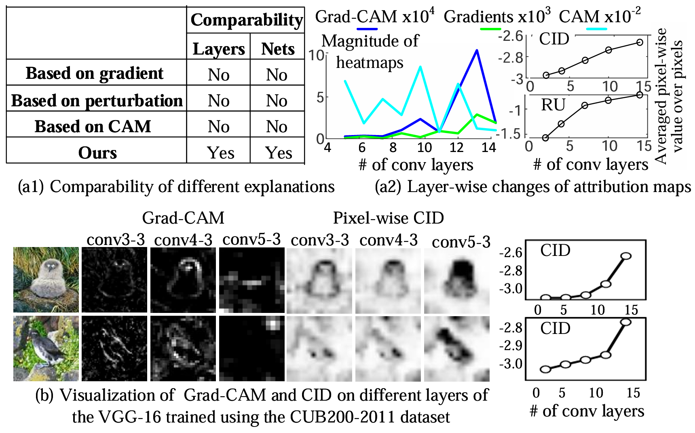
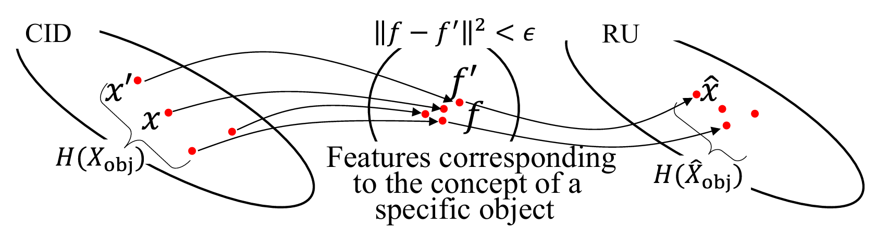
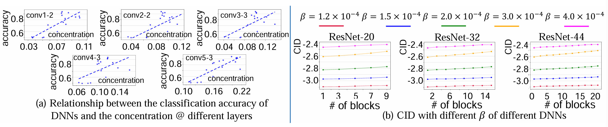
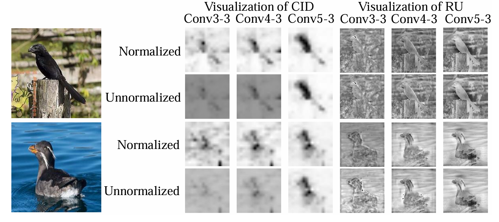
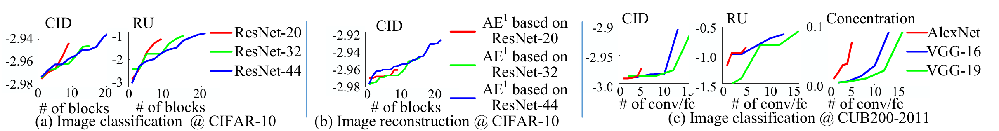
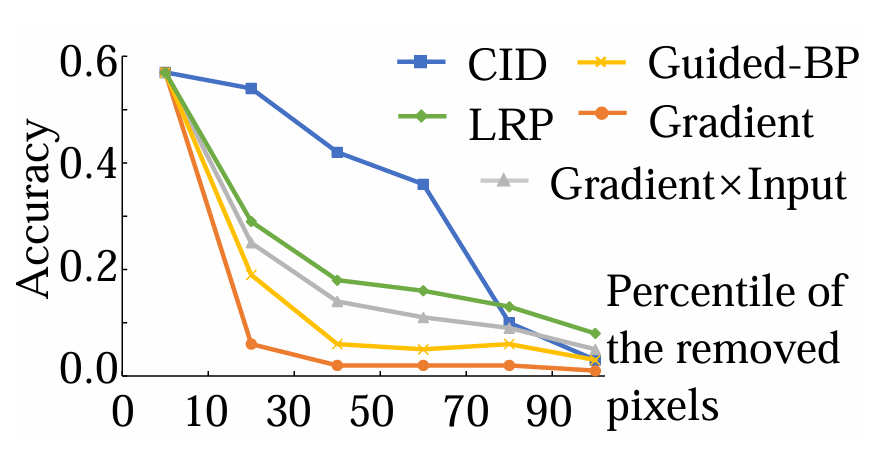
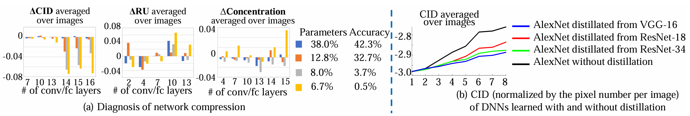

# 🧠 DeepInfo: Quantification and Analysis of Layer-wise and Pixel-wise Information Discarding

👉 **TL;DR.** DeepInfo measures how neural networks discard input information across layers and pixels. Explore **Computational Information Discarding (CID)**, **Reconstruction Uncertainty (RU)**, and information concentration with a simple PyTorch interface and a ready-to-run visual demo.

<p align="center">
  <a href="https://proceedings.mlr.press/v162/ma22b.html"><b>📄 ICML 2022 Spotlight</b></a> &nbsp; | &nbsp;
  <a href="https://proceedings.mlr.press/v162/ma22b/ma22b.pdf"><b>📕 Paper PDF</b></a> &nbsp; | &nbsp;
  <a href="#-quickstart"><b>🚀 Quickstart</b></a> &nbsp; | &nbsp;
  <a href="#-demo"><b>🧪 Demo</b></a> &nbsp; | &nbsp;
  <a href="#-figure-map"><b>🗺️ Figures</b></a>
</p>

## 🎥 Overview

<p align="center">
  
</p>

**Figure 1.** CID enables comparisons between different network layers and architectures, unlike the attribution magnitudes of conventional gradient-, perturbation-, and CAM-based explanations. On VGG-16 trained with CUB-200-2011, pixel-wise CID also reveals how the spatial distribution of discarded information changes with depth.

**DeepInfo** visualizes information discarding at individual input locations and across successive neural-network layers. The project is based on [*Quantification and Analysis of Layer-wise and Pixel-wise Information Discarding*](https://proceedings.mlr.press/v162/ma22b.html), **ICML 2022 Spotlight**.

## ✨ Highlights

- 🧠 **Computational Information Discarding.** Pixel-wise CID maps from PyTorch models.
- 📊 **Layer-wise analysis.** Compare information discarding across network layers.
- 🔬 **Reconstruction Uncertainty.** Analyze input reconstruction using learned decoders.
- 🎯 **Information concentration.** Compare foreground and background regions.
- ⚡ **Model integration.** Support custom layers, output targets, and input channels.
- 🧪 **Runnable demo.** Bundled images, model checkpoint, visualizations, and tests.

---

## 🔎 Comparison of Methods

| Explanation family | Comparable across layers | Comparable across networks |
|---|:---:|:---:|
| Gradient-based | No | No |
| Perturbation-based | No | No |
| CAM-based | No | No |
| **CID (ours)** | **Yes** | **Yes** |

Conventional attribution maps can identify important image regions, but their magnitudes do not directly support comparisons across different layers or architectures. CID measures pixel-wise information discarding on a common basis. See [Figure 1](assets/figures/fig1.png).

---

## 📊 Main Results

The ICML 2022 paper evaluates information discarding across network architectures, layers, and input regions, and investigates information processing under model compression and knowledge distillation.

**Weakly supervised object localization accuracy** from the [ICML 2022 presentation](https://icml.cc/media/icml-2022/Slides/17920.pdf):

| Method | ResNet-50 ↑ | VGG-16 ↑ |
|---|:---:|:---:|
| CAM | .367 | — |
| Grad-CAM | .355 | .507 |
| LRP | — | .489 |
| **CID** | **.493** | **.578** |

<details>
<summary>🧠 Figure 2. Two views of input information</summary>

<br>

**Computational Information Discarding (CID)** measures the contribution of input information to the computed feature. **Reconstruction Uncertainty (RU)** measures the remaining uncertainty when reconstructing input values from that feature. They characterize different aspects of information retention.

</details>

<details>
<summary>🎯 Figure 3. Information concentration and classification</summary>

<br>

The paper examines the relationship between foreground information concentration and classification accuracy at different VGG-16 layers. It also studies how the CID depth profiles of ResNets vary with the regularization coefficient $`\beta`$.

</details>

<details>
<summary>🔬 Figure 4. Pixel-wise CID and reconstruction uncertainty</summary>

<br>

Visualizations on CUB-200-2011 compare CID and RU at conv3-3, conv4-3, and conv5-3. Normalized maps make spatial patterns easier to compare; unnormalized maps preserve the scale needed for layer-wise comparisons.

</details>

<details>
<summary>📈 Figure 5. Information discarding across network depth</summary>

<br>

Layer-wise CID and RU are evaluated across ResNet-20/32/44 on CIFAR-10, alongside image reconstruction results and CID, RU, and concentration measurements for AlexNet and VGG on CUB-200-2011.

</details>

<details>
<summary>🧪 Figure 6. Pixel removal and explanation fidelity</summary>

<br>

Pixels are removed according to the importance ranking of different explanation methods. The resulting classification-accuracy curves compare CID with Guided Backpropagation, LRP, gradients, and Gradient × Input.

</details>

<details>
<summary>🔄 Figure 7. Network compression and knowledge distillation</summary>

<br>

Changes in CID, RU, and concentration are examined after network compression. The paper also compares layer-wise CID for AlexNet trained with and without knowledge distillation from different teachers.

</details>

The [paper PDF](https://proceedings.mlr.press/v162/ma22b/ma22b.pdf) contains the original figures, experiments, and complete results. See [Paper Results](docs/PAPER_RESULTS.md) for an overview.

---

## ⚙️ Install

```bash
git clone https://github.com/AtheavenMa/DeepInfo.git
cd DeepInfo
python -m pip install -e '.[demo]'
```

## 🚀 Quickstart

```python
import torch
from deepinfo import explain

model = torch.nn.Sequential(
    torch.nn.Flatten(),
    torch.nn.Linear(3 * 16 * 16, 4),
)
image = torch.rand(3, 16, 16)

result = explain(model, image, grid=(4, 4), steps=20, noise_samples=4)
print(result.cid_map.shape)
print(result.cid_mean)
```

Select a hidden layer with `layer="layer3"`; optionally choose output targets or input channels. See [Method Guide](docs/METHOD.md) and [Custom Model Example](examples_custom_model.py).

**Run the complete demo:**

```bash
python demo.py
```

---

## 🧪 Demo

The bundled example computes CID maps for a small CNN at shallow, middle, and output layers, using a **32 × 32 RGB image**.

```bash
python demo.py
python demo.py --device cpu --steps 48 --noise-samples 12
python demo.py --output outputs/custom --grid 4
```

---

## 🗺️ Figure Map

Figures from the [ICML 2022 paper](https://proceedings.mlr.press/v162/ma22b.html).

| Figure | Description |
|---|---|
| [Figure 1](assets/figures/fig1.png) | Comparing explanation methods across layers and networks, with VGG-16 CID visualizations |
| [Figure 2](assets/figures/fig2.png) | Conceptual distinction between CID and reconstruction uncertainty |
| [Figure 3](assets/figures/fig3.png) | Classification accuracy versus concentration, and CID under different regularization coefficients |
| [Figure 4](assets/figures/fig4.png) | Normalized and unnormalized pixel-wise CID and RU at different VGG-16 layers |
| [Figure 5](assets/figures/fig5.png) | Layer-wise CID, RU, and concentration across CNN architectures and datasets |
| [Figure 6](assets/figures/fig6.png) | Classification accuracy after deleting pixels ranked by explanation methods |
| [Figure 7](assets/figures/fig7.png) | CID, RU, and concentration in network compression and knowledge distillation |

<details>
<summary>Show all figures</summary>

<br>

| | |
|---|---|
| <br>Figure 2 | <br>Figure 3 |
| <br>Figure 4 | <br>Figure 5 |
| <br>Figure 6 | <br>Figure 7 |

</details>

---

## 📖 Citation

**Paper:** Haotian Ma, Hao Zhang, Fan Zhou, Yinqing Zhang, Quanshi Zhang. **Quantification and Analysis of Layer-wise and Pixel-wise Information Discarding.** *Proceedings of the 39th International Conference on Machine Learning (ICML 2022)*, PMLR 162:14664–14698.

📄 [Official paper page](https://proceedings.mlr.press/v162/ma22b.html) · [PDF](https://proceedings.mlr.press/v162/ma22b/ma22b.pdf) · [Original code](https://github.com/haotianSustc/deepinfo)

Please cite the ICML 2022 paper if you use DeepInfo:

```bibtex
@InProceedings{pmlr-v162-ma22b,
  title = {Quantification and Analysis of Layer-wise and Pixel-wise Information Discarding},
  author = {Ma, Haotian and Zhang, Hao and Zhou, Fan and Zhang, Yinqing and Zhang, Quanshi},
  booktitle = {Proceedings of the 39th International Conference on Machine Learning},
  pages = {14664--14698},
  year = {2022},
  editor = {Chaudhuri, Kamalika and Jegelka, Stefanie and Song, Le and Szepesvari, Csaba and Niu, Gang and Sabato, Sivan},
  volume = {162},
  series = {Proceedings of Machine Learning Research},
  month = {17--23 Jul},
  publisher = {PMLR},
  pdf = {https://proceedings.mlr.press/v162/ma22b/ma22b.pdf},
  url = {https://proceedings.mlr.press/v162/ma22b.html}
}
```

GitHub also supports the [Citation metadata](CITATION.cff) in this repository.

## 🙏 Appreciation

This project builds on the [original ICML 2022 implementation](https://github.com/haotianSustc/deepinfo) and the CID applications in [SegJointGene](https://github.com/daifengwanglab/segjointgene).

## 📜 License

Licensed under [MIT](LICENSE).