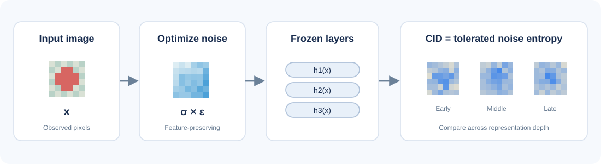
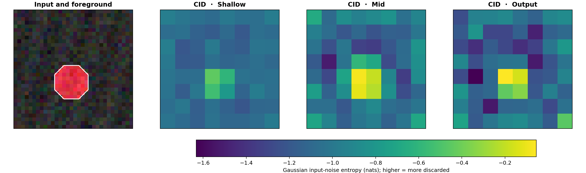
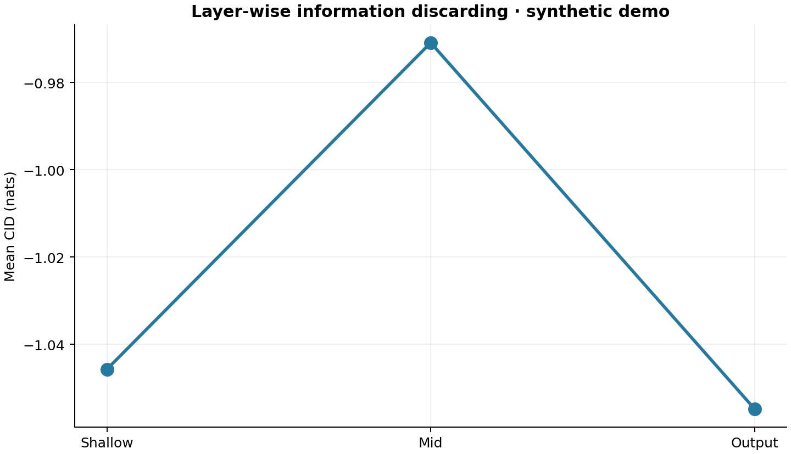

# 🧠 DeepInfo: Quantification and Analysis of Layer-wise and Pixel-wise Information Discarding

👉 **TL;DR.** DeepInfo measures how neural networks discard input information across layers and pixels. Explore **Computational Information Discarding (CID)**, **Reconstruction Uncertainty (RU)**, and information concentration with a simple PyTorch interface and a ready-to-run visual demo.

<p align="center">
  <a href="https://proceedings.mlr.press/v162/ma22b.html"><b>📄 ICML 2022 Spotlight</b></a> &nbsp; | &nbsp;
  <a href="https://proceedings.mlr.press/v162/ma22b/ma22b.pdf"><b>📕 Paper PDF</b></a> &nbsp; | &nbsp;
  <a href="#-quickstart"><b>🚀 Quickstart</b></a> &nbsp; | &nbsp;
  <a href="#-demo"><b>🧪 Demo</b></a>
</p>

## 🎥 Overview

<p align="center">
  
</p>

**DeepInfo** visualizes information discarding at individual input locations and across successive neural-network layers. The project is based on [*Quantification and Analysis of Layer-wise and Pixel-wise Information Discarding*](https://proceedings.mlr.press/v162/ma22b.html), **ICML 2022 Spotlight**.

## ✨ Highlights

- 🧠 **Computational Information Discarding.** Pixel-wise CID maps from PyTorch models.
- 📊 **Layer-wise analysis.** Compare information discarding across network layers.
- 🔬 **Reconstruction Uncertainty.** Analyze input reconstruction using learned decoders.
- 🎯 **Information concentration.** Compare foreground and background regions.
- ⚡ **Model integration.** Support custom layers, output targets, and input channels.
- 🧪 **Runnable demo.** Bundled images, model checkpoint, visualizations, and tests.

---

## 📊 Main Results

The ICML 2022 paper evaluates information discarding across network architectures, layers, and input regions, and investigates information processing under model compression and knowledge distillation.

**Weakly supervised object localization accuracy** from the [ICML 2022 presentation](https://icml.cc/media/icml-2022/Slides/17920.pdf):

| Method | ResNet-50 ↑ | VGG-16 ↑ |
|---|:---:|:---:|
| CAM | .367 | — |
| Grad-CAM | .355 | .507 |
| LRP | — | .489 |
| **CID** | **.493** | **.578** |

The [paper PDF](https://proceedings.mlr.press/v162/ma22b/ma22b.pdf) contains the original figures, experiments, and complete results. See [Paper Results](docs/PAPER_RESULTS.md) for an overview.

---

## ⚙️ Install

```bash
git clone https://github.com/AtheavenMa/DeepInfo.git
cd DeepInfo
python -m pip install -e '.[demo]'
```

## 🚀 Quickstart

```python
import torch
from deepinfo import explain

model = torch.nn.Sequential(
    torch.nn.Flatten(),
    torch.nn.Linear(3 * 16 * 16, 4),
)
image = torch.rand(3, 16, 16)

result = explain(model, image, grid=(4, 4), steps=20, noise_samples=4)
print(result.cid_map.shape)
print(result.cid_mean)
```

Select a hidden layer with `layer="layer3"`; optionally choose output targets or input channels. See [Method Guide](docs/METHOD.md) and [Custom Model Example](examples_custom_model.py).

**Run the complete demo:**

```bash
python demo.py
```

---

## 🧪 Demo

The bundled example computes CID maps for a small CNN at shallow, middle, and output layers, using a **32 × 32 RGB image**.

```bash
python demo.py
python demo.py --device cpu --steps 48 --noise-samples 12
python demo.py --output outputs/custom --grid 4
```

<p align="center">
  
</p>

**CID maps across three neural-network representations.**

<p align="center">
  
</p>

The demo saves `demo_output.png`, `layerwise.png`, `attribution.npz`, and `summary.json` to `outputs/demo/`. Read the [Demo Guide](docs/DEMO.md) or view the [recorded results](assets/summary.json).

---

## 🗺️ Figure Map

| Figure | Description |
|---|---|
| [Overview](assets/figures/overview.svg) | Layer-wise and pixel-wise information discarding |
| [CID Demo](assets/demo_output.png) | Input image and information discarding maps |
| [Layer-wise Demo](assets/layerwise.png) | CID across successive model layers |
| [ICML 2022 Paper](https://proceedings.mlr.press/v162/ma22b/ma22b.pdf) | Original paper figures and experimental results |

---

## 📖 Citation

**Paper:** Haotian Ma, Hao Zhang, Fan Zhou, Yinqing Zhang, Quanshi Zhang. **Quantification and Analysis of Layer-wise and Pixel-wise Information Discarding.** *Proceedings of the 39th International Conference on Machine Learning (ICML 2022)*, PMLR 162:14664–14698.

📄 [Official paper page](https://proceedings.mlr.press/v162/ma22b.html) · [PDF](https://proceedings.mlr.press/v162/ma22b/ma22b.pdf) · [Original code](https://github.com/haotianSustc/deepinfo)

Please cite the ICML 2022 paper if you use DeepInfo:

```bibtex
@InProceedings{pmlr-v162-ma22b,
  title = {Quantification and Analysis of Layer-wise and Pixel-wise Information Discarding},
  author = {Ma, Haotian and Zhang, Hao and Zhou, Fan and Zhang, Yinqing and Zhang, Quanshi},
  booktitle = {Proceedings of the 39th International Conference on Machine Learning},
  pages = {14664--14698},
  year = {2022},
  editor = {Chaudhuri, Kamalika and Jegelka, Stefanie and Song, Le and Szepesvari, Csaba and Niu, Gang and Sabato, Sivan},
  volume = {162},
  series = {Proceedings of Machine Learning Research},
  month = {17--23 Jul},
  publisher = {PMLR},
  pdf = {https://proceedings.mlr.press/v162/ma22b/ma22b.pdf},
  url = {https://proceedings.mlr.press/v162/ma22b.html}
}
```

GitHub also supports the [Citation metadata](CITATION.cff) in this repository.

## 🙏 Appreciation

This project builds on the [original ICML 2022 implementation](https://github.com/haotianSustc/deepinfo) and the CID applications in [SegJointGene](https://github.com/daifengwanglab/segjointgene).

## 📜 License

Licensed under [MIT](LICENSE).
